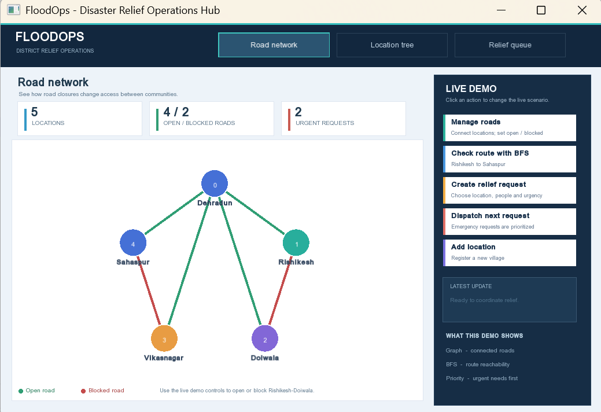

# FloodOps: Flood Relief and Evacuation Response Simulator

FloodOps is an operations simulator designed to coordinate regional disaster relief during severe flooding.

## UI Preview

## Key Features
- **Hierarchical Regional Tree:** Maps administrative divisions (District -> Village -> Area) using first-child/next-sibling pointers.
- **Road Network Graph:** Dynamic adjacency matrix supporting open and blocked road states during flooding.
- **BFS Route Engine:** Breadth-First Search traversal to compute open detours around submerged roads.
- **Dual-Tier Relief Queue:** Emergency requests prioritized via a Priority Queue, with standard supplies managed through a FIFO queue.
- **SFML Dashboard:** Real-time desktop visualization of road connectivity, regional hierarchies, and relief requests.

## Built With
- C++ / Custom Data Structures
- SFML 3 (Visualization Engine)