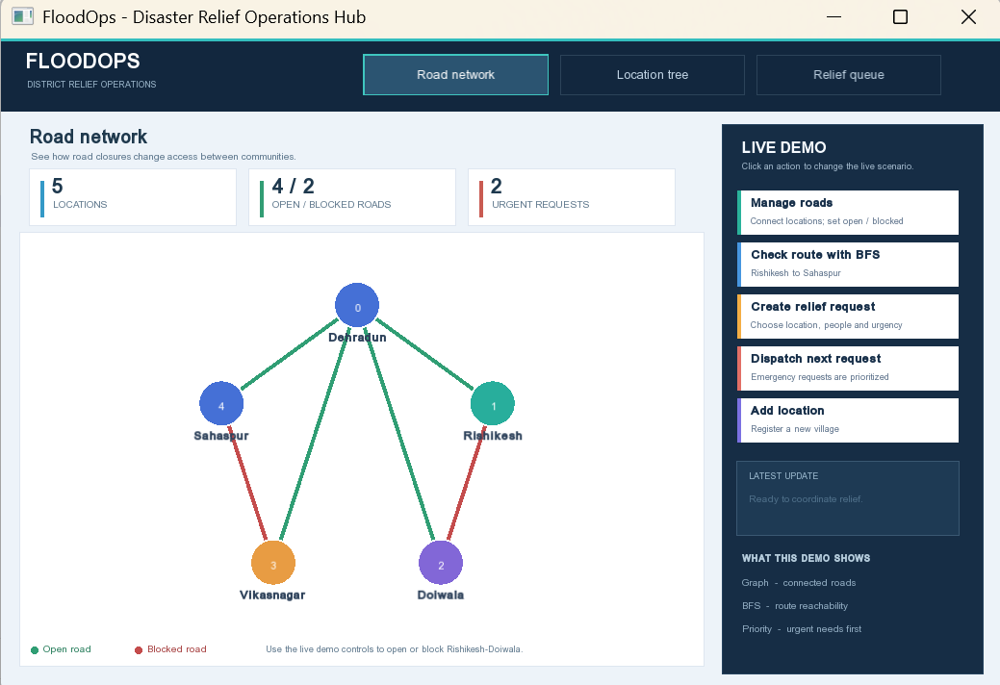

# FloodOps: Flood Relief and Evacuation Response Simulator

FloodOps is an operations simulator designed to coordinate regional disaster relief during severe flooding.

## UI Preview


## Key Features
- **Hierarchical Regional Tree:** Maps administrative divisions (District -> Village -> Area) using first-child/next-sibling pointers.
- **Road Network Graph:** Dynamic adjacency matrix supporting open and blocked road states during flooding.
- **BFS Route Engine:** Breadth-First Search traversal to compute open detours around submerged roads.
- **Dual-Tier Relief Queue:** Emergency requests prioritized via a Priority Queue, with standard supplies managed through a FIFO queue.
- **Shelter Capacity Tracker:** Allocates evacuees across shelters atomically, tracks occupancy by request, and supports partial or full release.
- **Request Lookup and Dispatch History:** A custom chained hash table indexes pending requests by ID; a custom linked stack records processed operations and their shelter assignments.
- **SFML Dashboard:** Real-time desktop visualization of road connectivity, regional hierarchies, and relief requests.

The dashboard dispatch action selects the highest-priority request, assigns every evacuee to available shelter capacity, and leaves the request queued if capacity is insufficient. Use **Add shelter** in the live demo panel or the **Shelters** tab to register named shelters in a selected region; the tab displays occupancy, connects regions by opening a road, and releases a processed request's shelter allocation. Dispatch can use a shelter in the request's region or any region reachable through open roads; blocked or missing roads prevent cross-region allocation. New locations are registered as 500-person shelters. Use **Look up request** in the live demo panel or **Look up request ID** on the Relief queue tab to search pending requests by ID using the custom hash table. The Relief queue tab also displays processed operation history. The console `RequestManagement` module uses the same lookup, shelter, and history components; register shelters there before dispatching requests.

## Built With
- C++ / Custom Data Structures
- SFML 3 (Visualization Engine)

## Build

CMake builds the SFML 3 dashboard when an SFML 3 development package is installed. Otherwise, it builds the console interface so FloodOps can still be compiled and used without the GUI dependency.

```powershell
cmake -S . -B build
cmake --build build
.\build\floodops.exe
```

To explicitly build without SFML:

```powershell
cmake -S . -B build -DFLOODOPS_USE_SFML=OFF
cmake --build build
```

The SFML dashboard requires a C++17 compiler and SFML 3 (Graphics, Window, and System). When using a package manager, install SFML 3 for the same compiler and architecture used by CMake. GCC 6.3 can build the console interface but is too old for the dashboard's C++17 requirement.